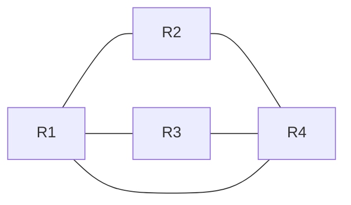

# HIDS NIDS Hybrid Infrastructure Progress

Last updated: 17 November 2026, Africa/Tunis

Configuration reference at this checkpoint: commit
`d40a5140c7b63ead4476ed528b41608fe84e81eb`. This is the repository version
used to document the checkpoint, not a claim about the commit of every
historical workflow run.

## Current result

We have a private GitHub repository, a working self-hosted Windows runner,
and a GNS3 lab containing four running Cisco routers connected by five
Ethernet links. All four IOS consoles have reached a command prompt.
GitHub Actions has successfully checked the initial two-PC lab and the
single-router hardware baseline.

The live interface workflow passed: all ten core link endpoints had their
expected addresses and `up/up` state, all ten directional neighbor ping
tests passed, and all four configurations were saved. The user explicitly
confirmed this successful result.

OSPF has now formed all five expected adjacencies. The live neighbor tables
show ten directional FULL entries: R1=3, R2=2, R3=2 and R4=3. The workflow
incorrectly reported zero because it did not parse IOS's padded `FULL/  -`
state. That parser is corrected in `d40a514`, with regression tests using
the supplied tables.

The user reports the OSPF workflow passed. Inspection of the downloaded
`core-ospf-43959781140-1.zip` confirms twelve remote OSPF /32 routes,
twelve loopback-source pings at 3/3, primary next hops through R2 in both
directions, and four `[OK]` save acknowledgements. The NVRAM confirmation
handler is validated by the live R2/R3/R4 save transcripts. Reboot
persistence remains a separate, untested property.

The corrected failover is verified from the downloaded live artifact for
run `44153014000`, commit `2cdd46d40a3824d6b9240e2e71e693e9a0e3570a`.
It establishes primary routing through R2, backup through R3 after shutting
R1 FastEthernet0/0, restored up/up state, primary recovery, and six measured
3/3 ping tests (both directions in all three phases). The original ZIP,
JSON files and metadata are [archived here](docs/evidence/2026-11-17/failover-success/README.md).

First valid backup polls occurred at 5.729 s on R1 and 6.029 s on R4.
First valid recovery polls occurred at 18.823 s on R1 and 8.617 s on R4.
These timers measure sequential route polling, not exact convergence or
packet loss. Optional traceroute capture is now verified from run 44156385861: six
traces confirm both directions through R2, then R3, then R2 again. The
[original artifact and inspection](docs/evidence/2026-11-17/failover-traceroute-success/README.md)
are archived with source commit 3c9e910742530e61f6c23b386ce1ce69095ad53d. The tertiary backup, VLANs,
firewall, HIDS/NIDS, monitoring, QoS and AWS/VPN remain future work.

| Work item | Status | Evidence |
| --- | --- | --- |
| Review architecture and define equipment roles | Completed | Architecture document reviewed and actual placement clarified |
| Windows and Ubuntu working environment | Confirmed | Ubuntu VM running with Internet access, as reported |
| Private repository and self-hosted runner | Working | Runner registered, connected and executed jobs |
| Two-PC GNS3 foundation | Verified | Five ping replies in each direction |
| Foundation workflow | Passed live | Successful GitHub Actions run reported |
| c7200 boot and adapter layout | Verified | IOS console output and GNS3 API data |
| Router hardware workflow | Passed live | Six Ethernet ports verified in job output |
| Four-router topology creation | Deployed | API artifact contains four routers and five expected links |
| Four-router startup and IOS prompts | Confirmed | All API statuses were `started`; user confirmed green devices and prompts |
| Interface addressing workflow | Passed live, as reported | User confirmed all tests passed and all four configurations were saved |
| Real core interface addresses and neighbor pings | Verified at the reported checkpoint | Ten endpoints up/up and ten directional tests at 3/3 required by the successful job; original result artifact has not been archived here |
| OSPF neighbor formation | Confirmed by supplied live output | Ten FULL entries in the four raw tables archived below |
| OSPF neighbor-state parser | Corrected and tested locally | Padded IOS state normalized; captured tables parse as 3/2/2/3 |
| OSPF route, routed ping and primary-path checks | Verified from downloaded live artifact | Twelve exact OSPF routes, twelve 3/3 pings, primary next hops through R2 in both directions |
| Complete OSPF job and final startup saves | User reports success; four saves verified in artifact | Four write memory outputs contain [OK]; reboot persistence has not been tested |
| Controlled OSPF failover and primary recovery | Verified from live artifact | Run 44153014000: restored=true, passed=true; raw routes, up/up and six 3/3 ping results |
| Traceroute during baseline, backup and recovery | Verified from live artifact | Six two-hop traces show R2, R3, R2 in both directions; run 44156385861 |
| Live repeat-deployment verification | Pending final evidence | Existing objects were reused during troubleshooting; a complete successful repeat run remains to be recorded |
| VLANs, managed switching, firewall, QoS, HIDS/NIDS and AWS/VPN | Not demonstrated | Architecture scope only at this checkpoint |

Evidence archives: [historical failures and neighbor tables](docs/evidence/2026-11-16/README.md)
[successful OSPF baseline](docs/evidence/2026-11-17/README.md),
and [successful failover](docs/evidence/2026-11-17/failover-success/README.md).

## 1 Environment and responsibilities

The two collaborators are on different networks. The runner and GNS3 are
on the friend's side, so GitHub jobs can operate the lab without a direct
connection from the author's Ubuntu VM.

| Component | Location | Role and observed configuration |
| --- | --- | --- |
| Author's Windows PC | Local workstation | Git repository, editing, documentation and GitHub access |
| Author's Ubuntu VM | VMware on local workstation | Running with Internet access; no connection into the GNS3 data network established yet |
| Friend's Windows PC | Remote workstation | GNS3 desktop/controller and self-hosted GitHub Actions runner |
| GNS3 VM | VMware on friend's PC | Linux compute server running Dynamips and lab devices |
| GitHub | Private repository | Version control, manual workflow dispatch and artifacts |

Repository: [HIDS-NIDS-hybrid-Infrastructure](https://github.com/MohamedAzizBouthelja/HIDS-NIDS-hybrid-Infrastructure)

Current connection settings:

| Setting | Value |
| --- | --- |
| GNS3 desktop version | `2.2.61` |
| GNS3 VM server version | `2.2.61` |
| Controller URL from the runner | `http://127.0.0.1:3076` |
| GNS3 VM address | `192.168.238.128:80` |
| GNS3 compute ID | `vm` |
| Runner labels | `self-hosted`, `Windows`, `X64`, `gns-lab` |

The runner was started interactively with `run.cmd`. Its terminal must
remain open unless a service is configured later. `127.0.0.1` in a job
refers to the friend's runner PC, not the author's PC or a GitHub-hosted VM.
The implemented workflows use local/private connections and require no
public GNS3 endpoint.

The hardware limitation was declared resolved. The earlier two-PC resource
constraint in the architecture document is no longer treated as a blocker.

## 2 Steps completed

### Architecture review

We reviewed the Word architecture plan and retained its five work areas:
LAN infrastructure, routing and resilience, QoS, local security/monitoring,
and AWS integration. CI/CD supports these areas throughout the project.

We clarified that the runner runs on Windows while GNS3's compute VM runs
Linux. We also established that the author's Ubuntu VM does not
automatically belong to the simulated GNS3 network.

### Initial management checks

On the friend's Windows browser, we checked the controller API:

- `/v2/version`: controller responds with its version.
- `/v2/computes`: the local compute and GNS3 VM are connected.
- `/v2/projects`: the intended project is visible and open.
- `/v2/projects/{project_id}/nodes`: devices have the expected IDs,
  compute placement and running state.

The desktop and VM versions both showed `2.2.61`.

### Two-PC foundation

We built a separate two-VPCS project, displayed as `untitled Foundation-Test`
in the supplied API response, and connected PC1 Ethernet0 to PC2 Ethernet0.
Both nodes ran on compute `vm`.

| Device | Interface | Address | Mask | Peer and result |
| --- | --- | --- | --- | --- |
| PC1 | `Ethernet0` | `192.168.1.10/24` | `255.255.255.0` | PC2 `Ethernet0`: five replies |
| PC2 | `Ethernet0` | `192.168.1.20/24` | `255.255.255.0` | PC1 `Ethernet0`: five replies |

The VPCS commands used were `ip <address> <mask>` and `ping <peer>`.
The `save` command was provided to persist their settings; persistence
across a restart has not been demonstrated separately.

We cloned the private repository onto the author's Windows PC and added
the first manually triggered workflow, **GNS3 foundation check**. Its live
success established GitHub Actions -> friend's runner -> GNS3 API access.
Its API checks establish device state; the manual pings separately
established packet connectivity.

### Single-router boot test

The equipment inventory contained a c7200 Dynamips template. QEMU VM and
IOU device lists were empty, and no managed switch image was available.

We created `Router-Boot-Test`, booted one router and inspected:

```text
show version
show ip interface brief
```

The console confirmed Cisco IOS `15.3(3)XB12`, platform `7206VXR`, NPE-400
and 512 MiB RAM. The `R1#` prompt established that IOS had booted and was
accepting privileged commands.

The initial template had two FastEthernet ports and four serial ports.
The test node was manually changed to six FastEthernet ports. This was a
node change; the original reusable template was not assumed to have changed.
The deployment manifest now sets the required adapters explicitly.

### Router hardware and Idle-PC

We added **GNS3 router check**, which passed on the real runner and verified
the six Ethernet ports, VM placement, hardware properties and started state.

Its initial warning showed that Idle-PC was unset. GNS3 calculated several
candidates, and `0x60630338` was selected and confirmed in the API response.
The console stayed responsive. A screenshot showed GNS3 VM CPU usage around
6.3%; no before measurement exists, so no percentage improvement is claimed.

### Four-router deployment

We implemented **GNS3 core topology** with a JSON manifest and PowerShell
deployment script. A live `plan` run correctly proposed one new project,
four routers and five links. Subsequent apply runs created those objects.

The deployment uses stable IDs and adds missing objects. It refuses
unexpected existing hardware or links instead of replacing them. It does
not modify the two baseline projects, delete devices, or stop routers.
Starting stopped routers is a separate workflow checkbox.

After the troubleshooting below, the supplied `after.json` showed all four
routers `started` and all five expected links. The user then confirmed all
four devices were green and their IOS consoles reached prompts.

## 3 Current router and topology configuration

All four deployed routers use this hardware baseline:

| Property | Value |
| --- | --- |
| Emulator and compute | Dynamips on `vm` |
| IOS image | `c7200-adventerprisek9-mz.153-3.XB12.image` |
| Platform / processor / midplane | `c7200` / `npe-400` / `vxr` |
| RAM | 512 MiB per router |
| NVRAM | 512 KiB |
| Idle-PC | `0x60630338` |
| Slot 0 | `C7200-IO-FE` |
| Slots 1-5 | `PA-FE-TX` |
| Slot 6 | Empty |
| Interfaces | `FastEthernet0/0` through `FastEthernet5/0` |

The MAC address and Dynamips runtime ID are assigned independently by
GNS3, rather than copied from the test router.



The cables below exist and their ten endpoint addresses were configured
and verified by the successful live interface job, as confirmed by the
user. OSPF's supplied neighbor tables also show the corresponding peer
addresses on these same interfaces.

| Link | First endpoint and configured IP | Second endpoint and configured IP | Subnet |
| --- | --- | --- | --- |
| R1-R2 | R1 `FastEthernet0/0`: `10.0.12.1` | R2 `FastEthernet0/0`: `10.0.12.2` | `10.0.12.0/30` |
| R2-R4 | R2 `FastEthernet1/0`: `10.0.24.1` | R4 `FastEthernet0/0`: `10.0.24.2` | `10.0.24.0/30` |
| R1-R3 | R1 `FastEthernet1/0`: `10.0.13.1` | R3 `FastEthernet0/0`: `10.0.13.2` | `10.0.13.0/30` |
| R3-R4 | R3 `FastEthernet1/0`: `10.0.34.1` | R4 `FastEthernet1/0`: `10.0.34.2` | `10.0.34.0/30` |
| R1-R4 | R1 `FastEthernet2/0`: `10.0.14.1` | R4 `FastEthernet2/0`: `10.0.14.2` | `10.0.14.0/30` |

Every core link uses mask `255.255.255.252` (/30). The OSPF cost policy is
defined in `gns3/ospf.json`: R1-R2 and R2-R4 have cost 10 per direction;
R1-R3 and R3-R4 have cost 30; the direct R1-R4 link has cost 100. This
intends transit costs of 20 for the primary R1-R2-R4 path, 60 for the
secondary R1-R3-R4 path and 100 for the direct backup. The supplied
neighbor tables do not prove selected route metrics or next hops; the
live routing-table verification is now archived in the 17 November checkpoint.

### Complete physical interface register

`V` means the endpoint belongs to the successful live interface checkpoint
reported by the user and is corroborated by a supplied FULL neighbor row.
`U` means the current workflows do not configure or connect that port.
For U ports, no current live `show ip interface brief` output was supplied;
do not interpret the manifest's lack of an address as a fresh observation
of the router's complete running configuration.

| Router | Interface | Configured IP and prefix | Connected peer | OSPF cost in manifest | Evidence |
| --- | --- | --- | --- | --- | --- |
| R1 | `FastEthernet0/0` | `10.0.12.1/30` | R2 `FastEthernet0/0`, `10.0.12.2` | 10 | V |
| R1 | `FastEthernet1/0` | `10.0.13.1/30` | R3 `FastEthernet0/0`, `10.0.13.2` | 30 | V |
| R1 | `FastEthernet2/0` | `10.0.14.1/30` | R4 `FastEthernet2/0`, `10.0.14.2` | 100 | V |
| R1 | `FastEthernet3/0` | None assigned by workflows | Unused | Not configured | U |
| R1 | `FastEthernet4/0` | None assigned by workflows | Unused | Not configured | U |
| R1 | `FastEthernet5/0` | None assigned by workflows | Unused | Not configured | U |
| R2 | `FastEthernet0/0` | `10.0.12.2/30` | R1 `FastEthernet0/0`, `10.0.12.1` | 10 | V |
| R2 | `FastEthernet1/0` | `10.0.24.1/30` | R4 `FastEthernet0/0`, `10.0.24.2` | 10 | V |
| R2 | `FastEthernet2/0` | None assigned by workflows | Unused | Not configured | U |
| R2 | `FastEthernet3/0` | None assigned by workflows | Unused | Not configured | U |
| R2 | `FastEthernet4/0` | None assigned by workflows | Unused | Not configured | U |
| R2 | `FastEthernet5/0` | None assigned by workflows | Unused | Not configured | U |
| R3 | `FastEthernet0/0` | `10.0.13.2/30` | R1 `FastEthernet1/0`, `10.0.13.1` | 30 | V |
| R3 | `FastEthernet1/0` | `10.0.34.1/30` | R4 `FastEthernet1/0`, `10.0.34.2` | 30 | V |
| R3 | `FastEthernet2/0` | None assigned by workflows | Unused | Not configured | U |
| R3 | `FastEthernet3/0` | None assigned by workflows | Unused | Not configured | U |
| R3 | `FastEthernet4/0` | None assigned by workflows | Unused | Not configured | U |
| R3 | `FastEthernet5/0` | None assigned by workflows | Unused | Not configured | U |
| R4 | `FastEthernet0/0` | `10.0.24.2/30` | R2 `FastEthernet1/0`, `10.0.24.1` | 10 | V |
| R4 | `FastEthernet1/0` | `10.0.34.2/30` | R3 `FastEthernet1/0`, `10.0.34.1` | 30 | V |
| R4 | `FastEthernet2/0` | `10.0.14.2/30` | R1 `FastEthernet2/0`, `10.0.14.1` | 100 | V |
| R4 | `FastEthernet3/0` | None assigned by workflows | Unused | Not configured | U |
| R4 | `FastEthernet4/0` | None assigned by workflows | Unused | Not configured | U |
| R4 | `FastEthernet5/0` | None assigned by workflows | Unused | Not configured | U |

### Loopback and OSPF router ID register

| Router | Logical interface | Address configured by the OSPF workflow | Mask | OSPF router ID observed in peer tables |
| --- | --- | --- | --- | --- |
| R1 | `Loopback0` | `10.255.0.1/32` | `255.255.255.255` | `10.255.0.1` |
| R2 | `Loopback0` | `10.255.0.2/32` | `255.255.255.255` | `10.255.0.2` |
| R3 | `Loopback0` | `10.255.0.3/32` | `255.255.255.255` | `10.255.0.3` |
| R4 | `Loopback0` | `10.255.0.4/32` | `255.255.255.255` | `10.255.0.4` |

These addresses are the OSPF configuration targets, and the live tables
confirm all four router IDs. Those tables alone do not prove Loopback0's
running IP/mask, route advertisement, reachability or startup persistence.
The successful artifact now retains remote /32 routes and loopback-source
pings; a reboot persistence test remains pending. No VLAN subinterfaces, tunnels or other
logical router interfaces have been deployed by the current workflows.

### Management and console endpoint register

| Endpoint | IP or host | Port | Purpose and evidence limit |
| --- | --- | --- | --- |
| Windows GNS3 controller | `127.0.0.1` on friend's PC | TCP 3076 | Current API URL used successfully by the runner |
| GNS3 VM server | `192.168.238.128` | TCP 80 | Server address from VM console and compute API |
| GNS3 VM SSH | `192.168.238.128` | TCP 22 | Advertised by VM console; SSH use was not demonstrated |
| Core R1 console | `192.168.238.128` | TCP 5001 | Observed core API snapshot; Telnet console |
| Core R2 console | `192.168.238.128` | TCP 5002 | Observed core API snapshot; Telnet console |
| Core R3 console | `192.168.238.128` | TCP 5003 | Observed core API snapshot; Telnet console |
| Core R4 console | `192.168.238.128` | TCP 5004 | Observed core API snapshot; Telnet console |
| Router-Boot-Test R1 console | `192.168.238.128` | TCP 5000 | Historical test-router API snapshot |
| Foundation PC1 console | `192.168.238.128` | TCP 5000 | Historical foundation API snapshot |
| Foundation PC2 console | `192.168.238.128` | TCP 5002 | Historical foundation API snapshot |

Console ports are allocations observed in different project snapshots;
the historical entries are not proof that all those endpoints are active
at the same time. Automation reads the current console host and port from
the API. The controller's earlier 3078 value is historical; 3080 was an
initial assumption, not the current setting.

### Author's Windows IPv4 adapter snapshot

The following was read directly from the author's Windows PC on
16 November 2026 through .NET network-interface APIs. The original
inspection result is preserved in
[local-workstation-ipv4.json](docs/evidence/2026-11-16/local-workstation-ipv4.json).
This is local host information, not an inspection of the friend's PC or
the Ubuntu guest.

| Windows interface alias | Observed IPv4 address/prefix | State | Observed gateway | Context |
| --- | --- | --- | --- | --- |
| `Wi-Fi` | `192.168.1.123/24` | Up | `192.168.1.1` | Intel Wi-Fi adapter; local workstation connectivity |
| `Ethernet` | `192.168.1.10/24`, `169.254.148.149/16` | Down | `192.168.1.1` configured | Realtek physical Ethernet adapter; not an active lab link |
| `Ethernet 4` | `192.168.56.1/24` | Up | None reported | VirtualBox Host-Only Ethernet Adapter |
| `VMware Network Adapter VMnet1` | `192.168.111.1/24` | Up | None reported | Windows-side VMware virtual adapter |
| `VMware Network Adapter VMnet8` | `192.168.74.1/24` | Up | None reported | Windows-side VMware virtual adapter |
| `Connexion au réseau local* 9` | `169.254.40.185/16` | Down | None reported | Microsoft Wi-Fi Direct virtual adapter |
| `Connexion au réseau local* 10` | `169.254.164.151/16` | Down | None reported | Second Microsoft Wi-Fi Direct virtual adapter |
| `Loopback Pseudo-Interface 1` | `127.0.0.1/8` | Up | None reported | Local Windows software loopback |

The /24 mask is `255.255.255.0`, the /16 mask is `255.255.0.0`, and the
/8 loopback mask is `255.0.0.0`. The `169.254.*` values are link-local
adapter addresses, not core router addressing. Adapter state and address
allocation can change; this table records the observation, not a permanent
assignment policy.

The physical local Ethernet value `192.168.1.10` also appears on the
separate historical Foundation-Test PC1. They identify different devices
in different network contexts; the author's down Ethernet adapter is not
the VPCS node. VMware's host adapter addresses are not Ubuntu guest IPs.
The author's VMnet8 subnet is also separate from the friend's observed
GNS3 VM endpoint `192.168.238.128`.

The friend's physical LAN/Wi-Fi interface names and IPs, the friend's
VMware adapter names/masks, the author's Ubuntu guest interface name/IP,
and the GNS3 VM's subnet mask have not been supplied. No values are
invented for those missing items. The planned VLAN 99 is not treated as
the currently deployed management network.

### Addressing reserved in the architecture only

These are future design values, not evidence of deployed services or
assigned physical ports:

| Future zone | Planned subnet | Planned gateway or peer addresses |
| --- | --- | --- |
| R1-pfSense | `10.0.1.0/30` | R1 `10.0.1.1`; pfSense `10.0.1.2`; interfaces not allocated |
| VLAN 10 clients | `192.168.10.0/24` | R1 gateway `192.168.10.1` |
| VLAN 30 test traffic | `192.168.30.0/24` | R1 gateway `192.168.30.1` |
| VLAN 99 management | `192.168.99.0/24` | R1 gateway `192.168.99.1` |
| VLAN 20 servers | `192.168.20.0/24` | R4 gateway `192.168.20.1` |
| VLAN 40 security | `192.168.40.0/24` | R4 gateway `192.168.40.1` |
| WireGuard | `10.20.0.0/30` | EC2 `10.20.0.1`; local peer `10.20.0.2` |
| AWS VPC | `10.10.0.0/16` | Public subnet example `10.10.1.0/24`; no instance IP recorded |

### Project identifiers

| Project | Project ID |
| --- | --- |
| Foundation-Test | `c2de961e-c2bb-4849-bda7-2ae06e3fd28b` |
| Router-Boot-Test | `7b095e33-a5df-43c0-818c-ccb01e8847d5` |
| Hybrid-Core-Lab | `cf3df97c-53f6-4ab7-a3d3-980d0fc96de7` |

The test router node ID is `812c3358-55d9-4e22-8aac-23f4eab1b483`.
GNS3 node UUIDs below identify simulator objects; they are different from
the IPv4 OSPF router IDs.

| Device | GNS3 node UUID | Observed MAC in supplied API snapshot |
| --- | --- | --- |
| Core R1 | `2930ccbf-4c3f-438c-ab59-171872e3b0c1` | `ca01.0a4e.0000` |
| Core R2 | `2930ccbf-4c3f-438c-ab59-171872e3b0c2` | `ca02.0a6a.0000` |
| Core R3 | `2930ccbf-4c3f-438c-ab59-171872e3b0c3` | `ca03.0a86.0000` |
| Core R4 | `2930ccbf-4c3f-438c-ab59-171872e3b0c4` | `ca04.0aa2.0000` |
| Foundation PC1 | `5de95601-d102-41c7-8e6e-1c8c58bf1262` | Not recorded in supplied node response |
| Foundation PC2 | `69af3695-e7f3-4aac-bdf5-23fa052d6be2` | Not recorded in supplied node response |

The Router-Boot-Test R1 has the same six interface names as the core
hardware baseline. Its supplied `show ip interface brief` showed all six
unassigned and administratively down at that earlier boot-test checkpoint;
it is a separate node, not the addressed core R1.

## 4 Troubleshooting record

| Issue | Diagnosis | Correction | Result |
| --- | --- | --- | --- |
| Controller port assumptions | Initial instructions used 3080; screenshots showed 3078, then the user confirmed 3076 | Updated workflow URLs, error messages and README to 3076 | Subsequent jobs reached the controller |
| Too few Ethernet interfaces | `PA-4T+` supplies serial ports, not four additional Ethernet ports | Adapted the test node to six Ethernet ports and encoded that layout in the manifest | IOS and API both showed `FastEthernet0/0` through `FastEthernet5/0` |
| Empty Idle-PC value | Hardware job warned about an unset value | Calculated candidates in GNS3 and selected `0x60630338` | API confirmed it was saved; console remained responsive |
| `Unexpected device 'R1 R2 R3 R4'` | The script treated an API JSON array as one pipeline item; the original mock incorrectly enumerated arrays | Explicitly enumerated REST responses; changed mocks to reproduce real REST array behavior | Exact failure reproduced locally, then corrected; later live execution reached the startup stage |
| `Not all routers are started` immediately after start requests | A single status check ran before the controller's state had settled | Added bounded polling, three consecutive all-started readings and per-router diagnostic artifacts | Later artifact showed all four started; user confirmed green devices |
| Default manifest path failed in the new interface entry point during local integration testing | Windows PowerShell parameter initialization encountered an empty script-root value | Resolved the default manifest path inside the script body | Actual entry-point integration test passed |
| Old setup text mistaken for a current question | Reconnected console replay included historical setup/login text | Read the current terminal tail instead of rejecting matching words anywhere in the buffer | Subsequent live run advanced through console checks |
| `Press RETURN to get started` rejected | The first Enter could precede IOS readiness | Permit up to two additional Enter presses at that exact initial prompt; continue rejecting password and yes/no questions | Interface workflow later passed live, as confirmed by the user |
| OSPF command timed out despite a ready prompt | A `%LINEPROTO-5-UPDOWN` log split `no passive-interface FastEthernet1/0` in the command echo | Handle recognized structured IOS syslog while checking ordered echo characters, current prompt and command errors | Exact TCP reproduction passed; live OSPF run subsequently reached neighbor verification |
| `neighbors=0` although all peer states were FULL | Parser required `FULL/-` and discarded IOS's padded `FULL/  -` rows | Normalize state whitespace; archive the captured tables; label counts `parsed_neighbors` and print raw tables on failure | Supplied live tables prove all ten FULL entries; corrected parser tests pass; successful baseline artifact now archived on 17 November |
| `write memory` waited at NVRAM `[confirm]` | IOS warned that the previous startup configuration was written by a different image version | Confirm only the exact warning after `write memory`, once; retain the output and require `[OK]`; reject other/repeated/bootstrap confirmations | Local tests pass; live R2/R3/R4 confirmation and all four [OK] saves archived on 17 November |

The startup issue was diagnosed using the saved artifact instead of deleting
and rebuilding the project. The corrected workflow reuses existing devices
and links. A start acknowledgement is not treated as proof of completed
IOS boot.

When publishing a fix, start a new workflow run on the updated `main` branch.
GitHub's **Re-run jobs** uses the failed run's original commit.

## 5 Interface automation passed live

The **GNS3 core interfaces** workflow was introduced in `d316805` and
subsequently received the console handling fixes above. The user confirmed
that its live run passed all tests and saved the four configurations.
It has two modes:

- `plan`: reads the API, validates the existing topology and displays the
  intended addresses. It opens no consoles and changes no IOS settings.
- `apply`: reads all target interface configurations first, records backups,
  configures missing hostname/IP/activation settings, verifies links and
  pings, then saves the configurations.

The commands it can apply include:

```text
configure terminal
hostname R1
interface FastEthernet0/0
ip address 10.0.12.1 255.255.255.252
no shutdown
exit
end
```

That example is R1's first link. The remaining commands are generated from
the manifest. Matching settings are skipped on repeat runs. Unused
interfaces and routing protocols are outside this workflow's scope.

Verification uses `show ip interface brief`, an ARP warm-up ping and a
separate measured command such as:

```text
ping 10.0.12.2 repeat 3 timeout 1
```

All ten endpoints must show the intended address and `up/up`; all ten
directional neighbor tests must return 3/3 replies. Only then does the
workflow issue `write memory` on each router and require `[OK]`.

The console client handles Telnet negotiation, replayed console history,
bounded initial RETURN prompts and syslog-interrupted command echoes. It
stops on command errors, password prompts or unanswered yes/no setup
dialogs. Unexpected existing IPs,
VRFs and unnumbered interfaces are refused. All four console preflights
must pass before configuration starts.

There is no automatic rollback. A failure may leave partial running
configuration. Startup configurations are saved only after all link tests
pass, although a failure during saving can leave some routers saved and
others unsaved. Backups cover the managed hostname and interfaces, not the
entire device configuration.

### OSPF deployment and observed adjacency evidence

**GNS3 core OSPF** configures process 10 in area 0, explicit router IDs,
Loopback0 addresses and the per-link costs recorded above. It uses
`passive-interface default` and makes only the known inter-router ports
non-passive. Physical router links use OSPF point-to-point network type.
These settings describe the implemented workflow and configuration policy;
the raw neighbor table is proof of adjacency, not a complete running-config
dump of every setting.

The user supplied all four live tables from `neighbors.json`, attempt 40.
They contain the following entries:

| Local router | Local interface | Neighbor router | Neighbor router ID | Neighbor interface IP | Raw state |
| --- | --- | --- | --- | --- | --- |
| R1 | `FastEthernet0/0` | R2 | `10.255.0.2` | `10.0.12.2` | `FULL/  -` |
| R1 | `FastEthernet1/0` | R3 | `10.255.0.3` | `10.0.13.2` | `FULL/  -` |
| R1 | `FastEthernet2/0` | R4 | `10.255.0.4` | `10.0.14.2` | `FULL/  -` |
| R2 | `FastEthernet0/0` | R1 | `10.255.0.1` | `10.0.12.1` | `FULL/  -` |
| R2 | `FastEthernet1/0` | R4 | `10.255.0.4` | `10.0.24.2` | `FULL/  -` |
| R3 | `FastEthernet0/0` | R1 | `10.255.0.1` | `10.0.13.1` | `FULL/  -` |
| R3 | `FastEthernet1/0` | R4 | `10.255.0.4` | `10.0.34.2` | `FULL/  -` |
| R4 | `FastEthernet0/0` | R2 | `10.255.0.2` | `10.0.24.1` | `FULL/  -` |
| R4 | `FastEthernet1/0` | R3 | `10.255.0.3` | `10.0.34.1` | `FULL/  -` |
| R4 | `FastEthernet2/0` | R1 | `10.255.0.1` | `10.0.14.1` | `FULL/  -` |

This is ten directional observations across five unique adjacencies. The
old job's `full: false` fields reflect its parser result, not the raw IOS
state; the archive retains those fields to preserve that distinction.

The successful artifact now directly establishes:

- Twelve exact remote loopback /32 routes learned through OSPF 10.
- R1's route to `10.255.0.4` selects only `10.0.12.2` via
  `FastEthernet0/0`; R4's route to `10.255.0.1` selects only `10.0.24.1`
  via `FastEthernet0/0`.
- Twelve loopback-source ping tests, each returning 3/3 replies after a
  separate warm-up.
- Four OSPF configuration save acknowledgements from `write memory`.

The earlier failures remain documented as history. The successful ZIP, its
seven original JSON files, checksum and inspection summary are now archived
in [the 17 November checkpoint](docs/evidence/2026-11-17/README.md).
The filename identifies run 43959781140, attempt 1; commit SHA and execution
timestamps were not supplied in the artifact. A later user-supplied failover
job excerpt confirms baseline and backup checks passed but restoration failed;
see [the failure excerpt](docs/evidence/2026-11-17/failover-restoration-failure.txt).
The corrected successful run is now archived with raw primary, backup and
recovery evidence, commit SHA and timestamps. Six traceroutes are now verified in the later run 44156385861.

## 6 Tests and evidence

Local verification completed:

- 24 topology scenarios passed in Windows PowerShell, including array
  handling, drift rejection, interrupted deployment recovery, repeated
  apply, delayed startup and startup failures.
- The interface/decoder suite passed, including repeat apply, IP conflicts,
  unavailable consoles, down links, failed pings, command failures, replayed
  history, RETURN handling and structured syslog interruptions.
- NVRAM confirmation tests reproduce the exact save prompt over TCP,
  allow one expected Enter and a delayed `[OK]`, and reject repeated,
  unrelated, bootstrap-image and wrong-command-context confirmations.
- The OSPF suite passed, including captured live-table parsing, state
  padding, protocol/ID/cost conflicts, delayed neighbors/routes, wrong
  next-hop rejection, routed ping failures and partial-configuration recovery.
- Real TCP transport checks against a simulated console passed for normal
  commands, rejected commands, password prompts and setup dialogs.
- The actual interface and OSPF entry points passed plan/apply/repeat-apply
  integration tests against a local HTTP API and four TCP console servers.
  The generated evidence included ten interface ping records and twelve
  OSPF route records. These records describe the simulated test network.

These simulated results verify automation behavior. The separate live
interface success confirmation and supplied neighbor tables establish the
live milestones recorded above. Locally generated files under `artifacts/`
must not be presented as downloaded evidence from the friend's live lab.

Artifacts are retained by the workflows for seven days:

| Workflow | Evidence |
| --- | --- |
| Core topology | `plan.json`, `before.json`, `after.json`; start responses and startup status history when startup is requested |
| Core interfaces | Address plan, pre-change IOS interface backups, pending commands, applied-router record, console transcript and ping results |
| Core OSPF | `ospf-plan.json`, `before-ospf.json`, `pending-commands.json`, `neighbors.json`, `routes.json`, `loopback-pings.json`, `console-transcript.json`; later-stage files exist only if execution reaches them |

Historical supplied excerpts remain in the 16 November archive. The
17 November archive contains the original successful OSPF ZIP and extracted
JSON files. Original interface job logs and successful repeat-run evidence
are still outstanding. Local `artifacts/` outputs remain simulations.

## 7 Repository files and recorded commits

| File | Purpose |
| --- | --- |
| `.github/workflows/gns3-preflight.yml` | Read-only two-PC foundation check |
| `.github/workflows/gns3-router-check.yml` | Read-only test-router hardware check |
| `.github/workflows/gns3-core-deploy.yml` | Plan/apply topology creation and optional startup |
| `.github/workflows/gns3-core-interfaces.yml` | Plan/apply interface configuration and neighbor tests |
| `.github/workflows/gns3-core-ospf.yml` | Plan/apply OSPF, routes, loopback pings and saving |
| `gns3/core-topology.json` | Project, router hardware, IDs, links and addressing |
| `gns3/ospf.json` | OSPF router IDs, costs and required primary next hops |
| `scripts/Deploy-CoreTopology.ps1` | Additive topology deployment and state verification |
| `scripts/Configure-CoreInterfaces.ps1` | Interface workflow entry point |
| `scripts/CoreInterfaces.ps1` | Configuration preflight, changes, pings and saving |
| `scripts/IosConsole.ps1` | Telnet transport and IOS prompt/error handling |
| `scripts/Configure-CoreOspf.ps1` | OSPF workflow entry point |
| `scripts/CoreOspf.ps1` | OSPF preflight, configuration, neighbors, route and ping verification |
| `tests/Test-CoreTopology.ps1` | Simulated topology tests |
| `tests/Test-CoreInterfaces.ps1` | Simulated interface and Telnet decoder tests |
| `tests/Test-InterfaceTransport.py` | Optional local HTTP/TCP integration test |
| `tests/Test-CoreOspf.ps1` | Simulated OSPF configuration and verifier tests |
| `tests/fixtures/ospf-neighbors-ios.json` | Regression fixture transcribed from the supplied live neighbor tables |
| `docs/evidence/2026-11-16/` | Provenance notes and archived attempt-40 live neighbor records |
| `docs/evidence/2026-11-16/local-workstation-ipv4.json` | Direct local Windows IPv4 interface observation |
| `docs/evidence/2026-11-16/ospf-save-confirmation-failure.txt` | User-supplied NVRAM save-stage error excerpt; not a complete job log |
| `README.md` | Setup, operation, troubleshooting and limitations |
| `Progress.md` | This status, addressing, interface and evidence register |

Relevant commits present in the local repository:

| Commit | Change |
| --- | --- |
| `86b759e` | Read-only two-PC foundation workflow |
| `1140f69` | Read-only R1 hardware check |
| `70472fc` | Controller port corrected to 3076 |
| `03684d9` | Four-router topology deployment |
| `1f87948` | API array handling correction |
| `082cbfb` | Stable startup waiting and diagnostics |
| `d316805` | Interface addressing and neighbor-test automation |
| `082b7cd` | Current IOS prompt distinguished from replayed console history |
| `259d801` | Initial IOS RETURN prompt handling |
| `ea81eb3` | OSPF configuration and routed connectivity verification |
| `7982b56` | Syslog interruption handling during command echoes |
| `d40a514` | Padded OSPF neighbor-state parser correction |

## 8 Next actions

1. Commit and push the workflow changes for measuring packet loss.
2. Run **GNS3 core failover** in `apply` mode with `measure_loss` enabled.
3. Archive the live probe logs and compare backup and recovery timeout counts and time to sustained replies. The measurement mode has passed local testing.
4. Verify the direct R1-R4 tertiary backup in a separate controlled experiment.
5. Archive original interface job and repeat-deployment evidence if available.
6. Continue with managed switching, EIGRP comparison, QoS, security monitoring and AWS/VPN.

The failover workflow temporarily shuts only R1 FastEthernet0/0. Cleanup
attempts `no shutdown` even after a failed test or lost shutdown acknowledgement.
It never saves the temporary shutdown. A killed runner/process cannot execute
cleanup; in that case manually restore this interface before another run.

No managed switch, firewall, security monitoring stack, AWS instance or VPN
has been demonstrated in this session. Full hybrid infrastructure and
HIDS/NIDS validation remain future milestones.
